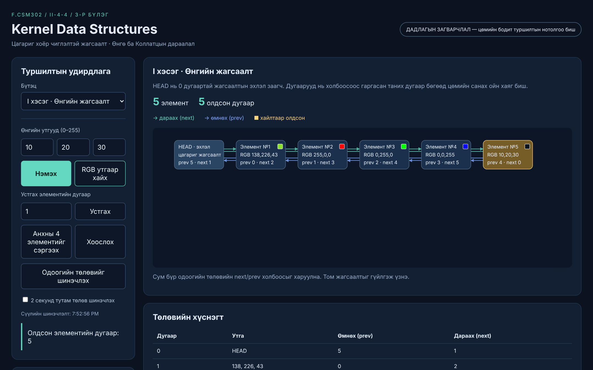
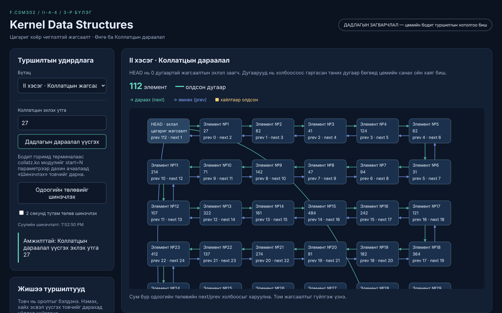

# Kernel data structure — II-4-4

**F.CSM302 · Бие даалт 2 (Final release `v2.0-final`)**

Бодит Linux kernel-ийн circular doubly linked list болон түүнийг `/proc`-оор уншдаг interactive graph.

## Хэрэгжүүлсэн зүйл

- **Part I / colors.ko:** ачаалахад 4 RGB элемент; kernel log-д traversal; unload үед safe deletion + kfree.
- **Part II / collatz.ko:** `start=25` default; параметрээс Collatz sequence үүсгэж linked list-д хадгалах, traversal/log, unload cleanup.
- **UI:** add, delete by ID, search RGB, clear/reset, next/prev graph, HEAD sentinel, snapshot inspector, JSON export, operation history.
- Хязгаар: RGB 0–255; colors 128 nodes; Collatz 4096 nodes, unsigned 64-bit overflow guard.

## Quick start: ажиллуулах (Windows, Linux, macOS)

Python 3.10+ суулгана. Сан нэмж суулгахгүй.

```bash
git clone https://github.com/Tergel0923/CSM302-II-4-4.git
cd CSM302-II-4-4
python3 src/ui/server.py --mode demo
```

Windows: `py src/ui/server.py --mode demo`.
Нээх: **http://127.0.0.1:8765**. Зогсоох: Ctrl+C.

## Quick start: Physical Core (Ubuntu VM)

Ubuntu 22.04/24.04 VM, kernel 5.6+, Python 3.10+, GCC/Make, running kernel-тэй ижил headers шаардлагатай.
Доорх командуудыг repository root-оос ажиллуулна:

```bash
sudo apt update
sudo apt install build-essential linux-headers-$(uname -r) python3 git
make kernel
sudo insmod src/kernel/colors.ko
sudo insmod src/kernel/collatz.ko start=15
sudo python3 src/ui/server.py --mode kernel
```

VM ашиглана.
Browser-ийг энгийн хэрэглэгчээр VM дотор нээнэ: http://127.0.0.1:8765.

```bash
# UI terminal-д Ctrl+C дарсны дараа:
sudo dmesg | grep -E 'kds_colors|kds_collatz'
sudo rmmod collatz
sudo rmmod colors
sudo dmesg | grep -E 'kds_colors|kds_collatz'
```

Collatz параметр солих:
```bash
sudo rmmod collatz
sudo insmod src/kernel/collatz.ko start=27
```
Дараа нь UI-ийн Шинэчлэх товчийг дарна. Windows/ердийн WSL2 дээр `.ko` ачаалах нь native Ubuntu VM-тэй адил биш; kernel headers/module support шаардлагатай.

## Бүтэц

| Зам | Агуулга |
|---|---|
| src/kernel/ | colors.c, collatz.c, shared arithmetic, Kbuild |
| src/ui/ | stdlib Python server, backend, HTML/SVG interactive UI |
| tests/ | model, HTTP, arithmetic, real kernel acceptance tests |
| docs/ | report/manual, review template, screenshots|
| tools/build_docs.py | PDF-ийг эх Markdown-оос дахин гаргах |

## Баг ба AI ашиглалт

Баг II-4-4:
- Э.Тэргэл: B210930801
- Б.Булгантамир: B241940123
- Т.Төгөлдөр: B242270050
- И.Зэлмэ: B231940158
- О.Амина: B241910800
- М.Наранбат: B242270801
  
Код, UI, тест, баримт бичгийг ChatGPT/Codex-ийн тусламжтай боловсруулсан. Бие даалт 2-ын (шүүмжийн засвар, дахин туршилт, Final Report, Manual, Poster) ажлыг Claude (Anthropic)-ийн тусламжтай боловсруулж, баг хянан баталгаажуулсан.

## Эх сурвалж

- Silberschatz, Galvin, Gagne. *Operating System Concepts*, 10th ed., 2018. Chapter 3, Programming Project 4, printed P-19–P-22.
- F.CSM302: BD1 Guide, Topic and Peer Review Allocation, Peer Review Guide (өгсөн PDF).

Шүүмжлэх баг: **IV-2-7 — Fork-Join Sorting Application**.


## Жишээгээр турших ба орчин оношлох

```bash
make help         # боломжтой командууд
make doctor       # дадлагын Python орчин
make doctor-live  # Linux, GCC, Make, matching kernel headers
make run          # make demo-той ижил
```

Вэбийн товчнууд RGB эсвэл Коллатцын эхлэх утгыг бэлдэнэ. Дараа нь үйлдлийн товчийг дарна. Граф дээр өнгийн элементийг сонгоход RGB болон устгах дугаар бөглөгдөнө.

## Бие даалт 2: шүүмжийн дагуу сайжруулалт

Албан ёсны peer review (4-2-11 → II-4-4)-ийн 5 шүүмжийг [Final Report](docs/II-4-4_Final_Report.pdf)-д хариулсан. Гол өөрчлөлт: Part II дээр Part I удирдлага нуух, 403 үед «Ctrl+R» санамж, граф 1–8 баганаар өргөнд зохицох ба төвлөрөх, скриншотуудыг одоогийн UI-аас дахин авсан.

| Part I: add + search | Part II: Collatz 27 (112 node) |
|---|---|
|  |  |

Шинэ тест (`make test` = 27 Python + C; `make test-ui`; `make test-browser`):

```bash
make test           # tests/test_review_regression.py орно
make test-ui
CHROME_PATH=/usr/bin/chromium make test-browser   # npm i playwright-core шаардана
make evidence       # Ubuntu VM: бодит kernel нотолгоо -> docs/evidence/live/
```

Screenshot-ууд бүгд practice горимынх (UI-ийн толгойн badge-д харагдана). Бодит kernel нотолгоо (Ubuntu VM) тусад нь `docs/evidence/live/`-д орно.
